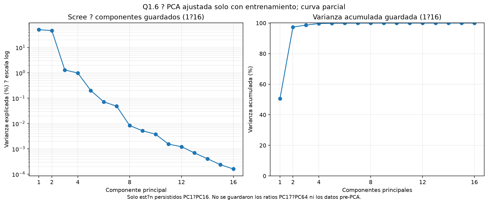

# QNIM Pre-PCA Dimensionality Audit

**Audit ID:** `QNIM_PRE_PCA_DIMENSIONALITY_AUDIT_V1`
**Scope:** audit only. No dataset generation, model fitting, final-test access, or historical-file modification.

## Evidence labels

- **Verified from source:** `n_pca_fit` is passed as `PCA(n_components=...)`; `PCA.fit()` receives `X_train_raw`, not a 64-row subset.
- **Derived from metadata:** the frozen protocol retains 200 train and 50 validation examples per class over 13 classes; the cache stores 16 PCA columns.
- **Assumptions:** memory estimates use float64 for pre-PCA data, consistent with the NumPy FFT path and the persisted PCA-array dtype; raw-array dtype was not saved.
- **Unknown:** the effective numerical rank and whether the 64 leading directions are stable under train-only resampling.

## Executive findings

- The original per-event vector is **16,384 whitened time samples** (4 seconds at 4096 Hz).
- The centered training matrix has shape **2600 × 16,384**. Its mathematical nonzero-rank upper bound is **2599**; this is not the measured effective numerical rank.
- `n_pca_fit=64` means **64 requested principal components**, not 64 samples. PCA was fit on **all 2,600 training examples**; the cache retains only **16** components.
- The raw pre-PCA train/validation matrices and fitted PCA/scaler objects were not persisted. Consequently, the effective numerical rank, full variance curve, and an independent refit of the historical 16-dimensional transform cannot be computed from existing artifacts.
- **20, 24, and 32 components are technically feasible from the original representation**, but are not available in the current 16-component cache. No new waveform preprocessing is required; a separately versioned cache must retain at least 32 components.

## Pipeline in execution order

The Q1.6 data path uses `LIGOPCAAdapter._generate_one` and the validation-only generator in `scripts/run_qnim_q1_6_scaling_pilot.py`:

1. A seeded NumPy generator draws `mass1` uniformly from 10–80 solar masses, `mass2` from 10–`mass1`, and distance from 100–1000 Mpc.
2. PyCBC `get_td_waveform` generates the plus polarization with **IMRPhenomPv2**, a **4096 Hz** sampling rate, **4.0 s** duration, and **20 Hz** lower cutoff. Strict physics is enabled and fallback is forbidden.
3. The signal is truncated to its last 16,384 samples or left-padded to that length.
4. The class-specific beyond-GR injection modifies the waveform (mostly in the frequency domain; selected injectors construct a time-domain waveform).
5. The modified strain is whitened against the analytic aLIGO O3 PSD: frequency transform, division by `sqrt(PSD × df)`, 20–1024 Hz band-pass, and inverse transform.
6. Each whitened time series is normalized to unit L2 norm. The resulting **time samples themselves** are the input features; there is no separate handcrafted feature extractor.
7. The generator retains the first 200 seeded draws per class for train and the next 50 for validation. The 100 later draws per class are discarded. `np.stack(train_features)` creates `X_train_raw` with shape **(2600, 16,384)**; validation is stacked separately as **(650, 16,384)**.
8. The call is `pca.fit(X_train_raw)`. `n_fit = min(n_pca_fit, X_train_raw.shape[0] - 1, X_train_raw.shape[1])`, so `64` is the component count passed to `PCA(n_components=n_fit)`, not the sample count.
9. `MinMaxScaler(-1, 1)` is fit on train PCA scores only and applied to validation. There is **no feature-wise standardization before PCA**; the pre-PCA normalization is per-event L2 normalization after whitening.

The reference protocol reports no detector noise. These are whitened simulated waveforms, not injections into measured detector data.

### Exact feature layout

The adapter's `_generate_base_waveform` sets its target length from `int(duration * sample_rate)`. `_whiten_strain` returns an inverse FFT with the same `n`, and `_generate_one` returns that single array. With the recorded adapter settings, the runtime-derived length is **16,384**. Each column is one consecutive time sample of the same plus-polarization channel; there are no concatenated channels, STFT bins, or matched-filter columns in Q1.6.

The PCA fit input is therefore exactly **`X_train_raw.shape == (2600, 16384)`**. The report's theoretical centered-rank bound remains 2599; the alternative bound of 63 would apply only if there were 64 training rows, which there are not.

## PCA limits and rank

For `X_train` with 2,600 rows and 16,384 columns, centering gives:

`rank(X_train - mean) ≤ min(2600 − 1, 16384) = 2599`.

The exact effective numerical rank is **unknown**. Only the leading 16 explained-variance ratios were retained, and the raw matrix, singular values, and PCA object are absent. Positive ratios for the first 16 components establish that these were nonzero in the recorded fit, but do not determine a tolerance-based numerical rank or the rank after PC16.

PCA ratios are not the same as available components: generation fitted 64 directions on the 2,600-row matrix, but only 16 projected dimensions and their ratios were saved. The cache cannot supply PCs 17–64. In source, `n_fit` is capped by the number of training rows minus one and feature count, then used as `PCA(n_components=n_fit)` before `pca.fit(X_train_raw)`.

## PCA stability and fitting protocol

- **Sample selection:** 200 seeded train examples per class (13 classes), followed by 50 validation examples per class. The first 200 generated draws in each class block are train; PCA uses all 2,600. Labels are not passed to PCA.
- **Seed:** dataset and PCA `random_state` are both 42.
- **Solver:** `svd_solver` is not specified, so scikit-learn 1.7.2 defaults to `auto`. For shape (2600, 16384) and 64 components, its policy selects the **randomized** solver (`64 < 0.8 × 2600` and the matrix dimensions exceed 500).
- **Scaler:** MinMax statistics are fit on the same 2,600 training rows after projection. Validation is transformed only.
- **Stability conclusion:** 2,600 rows are sufficient to request 64 components algebraically, but this alone does not establish a stable basis. Stability depends on the raw singular spectrum/eigenvalue gaps and resampling variability, neither of which is available. The high cumulative variance is not evidence that individual directions are stable. No bootstrap or repeated train-only PCA fit was performed.

## Variance analysis

The metadata preserves the first 16 training-fitted ratios. Their cumulative sum is **99.998673%**. The full 64-component or full-rank scree curve is unavailable, so the attached figure deliberately shows only the stored prefix.

| PC | Explained variance | Cumulative |
|---:|---:|---:|
| 1 | 50.524654% | 50.524654% |
| 2 | 46.841583% | 97.366237% |
| 3 | 1.295873% | 98.662109% |
| 4 | 0.992536% | 99.654645% |
| 5 | 0.201866% | 99.856511% |
| 6 | 0.072230% | 99.928742% |
| 7 | 0.048303% | 99.977045% |
| 8 | 0.008396% | 99.985441% |
| 9 | 0.005156% | 99.990596% |
| 10 | 0.003814% | 99.994411% |
| 11 | 0.001541% | 99.995951% |
| 12 | 0.001220% | 99.997172% |
| 13 | 0.000693% | 99.997865% |
| 14 | 0.000410% | 99.998274% |
| 15 | 0.000238% | 99.998512% |
| 16 | 0.000161% | 99.998673% |

These are variance shares, not a feature-selection criterion. No low-variance component should be discarded solely on this basis; later components may still carry class-discriminative information.

## Comparison with the thesis methodology

The thesis's Section 3.1.1–3.1.2 (printed pages 21–22) describes a materially different feature pipeline:

| Aspect | Thesis | Q1.6 code/data |
|---|---|---|
| Input | Calibrated frequency-domain detector strain from GWOSC | Synthetic PyCBC IMRPhenomPv2 plus-polarization waveforms |
| Noise conditioning | Welch PSD from a 256-second off-source stretch; whitening and 20–1024 Hz bandpass | Analytic aLIGO O3 PSD whitening; no detector noise |
| Features before PCA | 0.5-second Tukey-window STFT with 50% overlap, concatenated with matched-filter MAP log-likelihood and first-order phase-space gradient; stated as O(10³) dimensions | One 16,384-sample whitened time-domain vector; no STFT or matched-filter statistics |
| PCA | Fit on training data; thesis section does not state the training sample count or solver | Fit on all 2,600 train examples; scikit-learn `auto` selects randomized |
| Scaling | Thesis describes min-max normalization to [0, π] after PCA; it does not specify feature-wise standardization before PCA in the reviewed section | No feature-wise standardization before PCA; train-fitted MinMax to [-1, 1] after PCA |
| 12-component cumulative variance | **95.2%** (Appendix Table C.2) | **99.997172%** from Q1.6 metadata |

The variance figures are **not directly comparable** because their input features, noise treatment, and data generation differ. The exact sample population and pre-PCA standardization used for the thesis table remain unspecified in the reviewed methodology. The repository's `LIGOPCAAdapter` docstring cites 95.3% and calls it “inter-class” variance, while the thesis table calls 95.2% cumulative explained variance. The Q1.6 implementation uses ordinary unsupervised PCA on `X_train_raw`; it computes no class-conditioned PCA objective.

The repository also has a generic `SklearnPreprocessor` that uses `StandardScaler → PCA → MinMaxScaler`, and a separate noise-injection adapter with optional matched-filter scores. Those are different code paths; neither is evidence that Q1.6 uses the thesis's STFT/matched-filter representation.

## Cache and historical reproducibility

Only `X_train`, `y_train`, `X_val`, `y_val`, and metadata are present in the Q1.6 cache. The existing train and validation hashes were recomputed from those arrays and match the approved dataset manifest. The first-12-component prefix hashes also match the frozen historical Q1 values exactly.

This confirms the integrity and historical correspondence of the **stored projections**; it does not independently reproduce the PCA transform from raw waveforms. The 16-component outputs are already MinMax-scaled, and neither raw features nor PCA mean/components nor scaler state were saved. A fresh PCA fit also has arbitrary component signs: a future numerical equivalence check must align each component sign (for example, by the dot product of matched training scores) before comparing projections.

## Feasibility and memory

| Target PCA dimension | Feasible from original representation? | Available in current cache? |
|---:|:---:|:---:|
| 20 | Yes | No |
| 24 | Yes | No |
| 32 | Yes | No |

All three targets are below the 16,384 input features, the 2,599 centered-rank upper bound, and the existing 64-component fit budget. They cannot be produced from the current cache because components beyond 16 and the PCA object/raw vectors are missing. No change to waveform sampling, whitening, or feature extraction is needed; the PCA projection/cache output must retain at least 32 dimensions.

The dimensions are structurally feasible, but the unavailable raw matrix means the actual numerical rank is not verified to be at least 32.

Estimated float64 storage:

- Training matrix: **325 MiB**.
- Validation matrix: **81.25 MiB**.
- Combined train/validation raw vectors: **406.25 MiB**.
- One centered PCA training copy: approximately **325 MiB**.
- A 64 × 16,384 PCA basis: approximately **8 MiB**.

The current generator also keeps individual waveform arrays in Python lists while stacking the train and validation matrices. Accounting for those lists, the stacked matrices, and one centered fit copy gives an estimated resident-memory floor of about **1.11 GiB**, before randomized-SVD workspace, BLAS buffers, and runtime overhead. This is an estimate, not a measured peak; budget additional memory.

## Required pipeline changes and recommendation

1. Generate a **new, separately versioned** train/validation cache retaining at least 32 PCA components. Preserve the existing 16-component cache unchanged.
2. Keep the frozen waveform protocol and train-only PCA fitting. `n_pca_fit=64` already exceeds the required 32; set retained `n_components` to at least 32.
3. Persist either the raw train/validation feature matrices or, at minimum, the fitted PCA mean/components and train-fitted scaler, plus ratios for every fitted component and numerical-rank diagnostics.
4. Create a new immutable dataset manifest and hashes. Verify the historical prefix after sign alignment; do not open or use the final test split.
5. After that integrity gate, use **16 as the baseline**, then evaluate **20, 24, and 32 PCA components** as separate experimental conditions. Do not infer the effective rank from the current 16-component variance summary.

### PCA32 preparation options

**A. Preserve the exact historical fit.** The historical fit used all 2,600 train rows and fitted 64 components, but its PCA object and components 17–64 were discarded. It cannot be extended from the current cache. Reproducing it would require recovering the original raw matrix or rerunning the frozen generator and refitting with the same preprocessing, scikit-learn version, solver, and random state. This offers the closest historical comparison, but exact numerical identity is not guaranteed by the present artifacts.

**B. Refit on all 2,600 training examples and retain 32.** This is leakage-safe if validation is transformed only. If the input matrix, preprocessing, solver, seed, and software versions match A, then B is effectively the same refit—not a different sample design. Changing those choices creates a new PCA basis and must be treated as a new data condition.

**Recommendation:** if later approved, refit on the same 2,600 historical training rows using the frozen Q1.6 settings, retain 32, and verify sign-aligned historical prefixes before publishing a new cache/manifest. Neither option was executed.

No model training was started as part of this audit.
