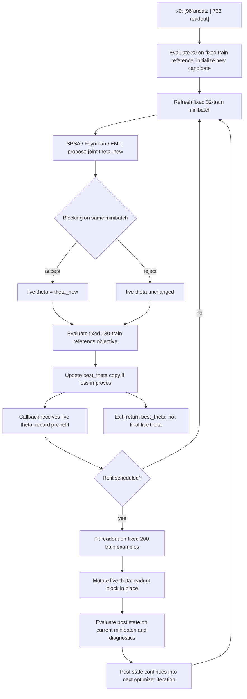

# QNIM V2 — Optimizer state management and quantum-learning design review

**Status:** design proposal only. No training, circuit simulation, Aer job, QPU job, test-data access, or V1 protocol/result/checkpoint modification was performed.

## 1. Root cause: live state, best state, and returned state

The relevant implementation is in [QNSPSAEMLFeynman](../../../src/infrastructure/qnspsa_eml_feynman.py), [QiskitVQCTrainer](../../../src/infrastructure/qiskit_vqc_trainer.py), and the [scaling runner](../../../scripts/run_qnim_quantum_pca_scaling.py). This trace is based on those functions, not their comments.

1. `minimize` starts with `theta = x0.copy()` and a separate `best_theta = theta.copy()`, but `best_loss` is initialized to infinity. The initial parameter vector is evaluated on the first 32-example minibatch, not the fixed reference objective, and therefore is not actually a scored best-state candidate.
2. At each iteration it refreshes a fixed training minibatch, evaluates the current point, computes SPSA/Feynman/EML terms, proposes one joint step over the combined parameter vector, and accepts or rejects that step. A rejected step leaves the live `theta` unchanged.
3. After blocking, `evaluate_reference(theta)` scores the **current full vector** on the fixed training reference indices. If this score beats `best_loss` by `min_improvement`, the optimizer copies the vector to `best_theta`. This comparison occurs before the trainer callback.
4. The optimizer calls `callback(t, theta, current_loss)` with its live array. In the V1 runner the trainer callback first passes a copy to the pre-refit diagnostic callback. At iterations 10 and 20, it then fits a new readout and assigns its 733 values into `theta[n_ansatz_params:]` in place. The 96 ansatz values are unchanged by that refit.
5. The trainer evaluates the post-refit state with `loss_fn(theta)` on the current 32-example minibatch, then passes a copy to the post-refit callback. The post-refit diagnostic metrics are separately measured on the fixed 65-example train and validation diagnostic subsets. The callback does **not** return this state or its loss to the optimizer's already-completed best-state comparison.
6. The in-place mutation persists: QNSPSA uses the post-refit `theta` as the start of the next iteration. At iteration 11 the blocking update was rejected, so its subsequent reference evaluation scored the unchanged iteration-10 post-refit vector; it was worse than the incumbent. At iteration 20 there is no next iteration, so the post-refit vector was never scored by `evaluate_reference`.
7. At exit, `minimize` returns `best_theta`, not the final live `theta`. `train_vqc` returns that as `weights`; the runner uses `weights` for final train/validation evaluation and serialization.

The reference set is built as `min(max(128, 10 * n_classes), n_train)`: 130 train examples for 13 classes. V1 explicitly passes `reference_shots=512`. The current result records the reference-loss values and protocol shot count but does not persist the reference example indices as a separately identified set.

### Answers to the lifecycle questions

| Question | Finding |
|---|---|
| Where is the live vector? | Local `theta` inside `QNSPSAEMLFeynman.minimize`; it contains both blocks. |
| Do refits mutate it? | Yes, the trainer writes the new readout slice into the callback's live `theta`. |
| Does the next iteration receive that state? | Yes. It is the next iteration's starting vector unless later optimizer steps change it. |
| Where is `best_theta` updated? | After the blocking decision and reference evaluation, before the callback. It is a copy of the complete current vector. |
| Is each post-refit state evaluated by the same reference objective before selection? | No, not immediately. The callback measures post-refit loss on the current 32-example minibatch. Iteration-10's state was incidentally reference-scored at iteration 11 because that update was rejected; iteration-20's post-refit state was not reference-scored. |
| Is the final model the best recorded state? | It is the best among states scored by the optimizer's reference-loss comparisons, not necessarily every pre/post snapshot in the trace. In this run the final vector matches iteration-1 pre-refit exactly. |
| Do objective and callback see identical parameters? | Before refitting, yes: the reference score and callback operate on the post-blocking live vector. The callback's scalar loss is the current 32-example minibatch loss, not the 130-example reference loss. After mutation, the post-refit evaluation and diagnostic callbacks use the new vector. |

This distinction refines the earlier diagnosis: it is inaccurate to say that *no* post-refit state was considered. The iteration-10 post-refit vector was scored one iteration later after the rejected iteration-11 step, but that score was not explicitly attached to the refit snapshot. The iteration-20 post-refit vector was omitted from best-state comparison. Also, the initial warm-start vector was not scored on the reference objective, despite being stored initially in `best_theta`. The final state is coherent—both parameter blocks come from iteration-1 pre-refit—but it is not the final live state and is not guaranteed to beat the unscored initialization.

## 2. Best-state policy alternatives

All three alternatives must select using training data only, compare complete `[ansatz | readout]` vectors, and keep validation strictly out of gradient updates and checkpoint selection.

| Strategy | Mathematical / scientific behavior | Cost and risks |
|---|---|---|
| **A. Remove periodic readout refits; jointly optimize all 829 parameters.** | The optimizer alone changes both blocks; no callback discontinuity. Existing SPSA/QNSPSA update equations and blocking remain unchanged. | Simplest lifecycle and fewer refit jobs. Does not itself solve block-scale imbalance, noisy gradients, or readout dominance; joint updates can still be rejected as one vector. It changes the training schedule relative to V1. |
| **B. Keep refits; score each complete post-refit vector on the fixed training-reference objective before checkpoint selection.** | Score the post-warm-start initial vector, every post-blocking pre-refit vector, and every post-refit vector on the same fixed reference set. Checkpoint selection includes a state only with its full vector, objective, phase, and hash. Gradient estimates, preconditioner, proposed update, and blocking mathematics need not change. | The initial candidate plus two post-refit comparisons add 390 circuits / 199,680 requested shots at q16 (about 1.13% of the previous run's circuit count; estimate, not measured). Finite-shot noise can rank close states incorrectly, so evaluation seeds/counts and a predeclared tie/improvement rule must be persisted. It does not prevent a refit from changing the live trajectory. |
| **C. Alternating optimization: explicitly optimize ansatz and readout in separate phases.** | Makes the schedule and block responsibilities explicit; can measure whether an ansatz update changes the quantum features before refitting the head. | A different optimizer schedule and objective trajectory; introduces phase lengths, block rates, and ordering choices. It is harder to attribute effects without additional controlled ablations and is not the least disruptive correction. |

### Recommendation: B for the first V2 implementation

B directly fixes the identified checkpoint-policy gap while preserving the V1 optimizer update mathematics and readout architecture. It keeps best-state selection tied to a single training-only reference objective, evaluates the initial warm-start candidate, and prevents a post-refit candidate from being silently omitted. It also makes iteration-20's post-refit state eligible rather than leaving it unscored.

The policy must store the state phase (`pre_refit` or `post_refit`) and compare all candidates by the same fixed training reference indices, shot count, loss definition, and class ordering. Persist per-example reference losses or sampler counts, the deterministic evaluation seed, and an uncertainty estimate. If the measured improvement is within a pre-registered shot-noise uncertainty band, retain the incumbent rather than treating noise as a real improvement. Validation scores must not break ties or choose the checkpoint. Strategy A (no refit) and C (alternation) remain later controlled ablations, not unannounced changes to this initial V2.

## 3. Quantum parameter learning: evidence and unknown causes

The saved q16 result shows a nonzero but small ansatz movement for the selected iteration-1 model: L2 change 0.006844 from an initialization norm of 0.074999, maximum coordinate change 0.000893. Across accepted optimizer updates 2–20, the accumulated block step lengths were 0.061409 for 96 quantum parameters and 0.168765 for 733 readout parameters. These are trajectory lengths, not net changes. The two readout refits changed only the classical block by L2 45.146 and 49.000.

The source establishes the following mechanisms:

- The SPSA perturbation is shared coordinate-wise: `c_t = 0.05 / t^0.167`; the base step rate is `a_t = 0.03 / t^0.602`. Rademacher perturbations cover the combined vector. At initialization, ansatz coordinates are sampled with standard deviation 0.01; the readout is fitted from measured features. Thus perturbation and initialization scales differ, but the saved evidence does not establish that this caused the small net ansatz movement.
- The QNSPSA code builds `F_hat` from outer products of two **loss-gradient estimates**, then applies a full-vector Sherman–Morrison preconditioner initialized as `0.003 I` for this learning rate and regularized on update. This is not a measured physical QGT/QFI. The matrix and its block effects were not saved, so preconditioning cannot be identified as the cause.
- Blocking accepts or rejects the proposed **joint** vector. Eleven rejected iterations apply zero parameter movement to both blocks; this directly reduces opportunities for quantum movement but does not explain the accepted-step block imbalance by itself.
- Refit callbacks overwrite the classical block but leave the ansatz block fixed. The large readout jumps are directly measured and explain a major portion of classical trajectory movement.
- Only `np.var(g_hat)` across the entire combined vector is stored. It is neither a quantum-block gradient norm nor evidence for a barren plateau. No gradient norm, blockwise gradient variance, preconditioner block summary, or accepted step norm by block was saved.
- Raw measured quantum features and feature sensitivities to ansatz changes were not persisted. It is therefore unknown whether a small ansatz update caused features to change, whether such changes exceeded 512-shot noise, or whether the measured features were insensitive to the ansatz.

No single cause among perturbation scale, preconditioning, blocking, initialization, parameter scale, refits, or measurement sensitivity can be established from this run. Future training should log, without changing optimizer mathematics:

1. `||g_hat_q||`, `||g_hat_readout||`, corresponding values for the second SPSA estimate, and blockwise variance; also the norms of Feynman, EML, combined gradient, preconditioned gradient, and proposed/applied step by block.
2. Quantum and readout parameter norms, per-block net change from initialization and per accepted step, relative movement with a declared denominator, and refit-only deltas.
3. Blocking loss delta, acceptance decision, batch ID, state hash, and whether the candidate was pre- or post-refit.
4. Fixed-example measurement-feature deltas with their shot standard errors before/after selected ansatz updates. Report the fraction/magnitude of changes exceeding combined measurement uncertainty; do not infer this from parameter norm alone.
5. Reference objective estimates and their shot uncertainty. Retain the full training-reference index list/hash and exact sampler seed schedule.

These are diagnostics, not grounds for claiming QFI, a physical quantum natural gradient, or barren-plateau mitigation.

## 4. Optional quantum measurement-observation artifact

Persist quantum measurements independently of MLP probabilities, using only fixed train and validation diagnostic examples. Do not include test rows.

### Row identity and metadata

Each row represents one `(attempt, parameter_state, split, example)` observation and includes:

- Immutable split-local example ID, split name (`train` or `validation`), and true class ID.
- Iteration and phase (`initial`, `pre_refit`, or `post_refit`).
- SHA-256 of the complete quantum parameter block and readout block, qubit count, requested and completed shots.
- UTC timestamp, backend name/version, simulator seed or hardware job ID, and dataset-manifest hash.
- 16 `P(q_i=0)` estimates and 15 adjacent `⟨Z_i Z_(i+1)⟩` estimates, in the documented qubit/feature order.
- Standard errors for each estimate when shots permit. For a marginal `p`, use `sqrt(p(1-p)/N)`; for a ±1 ZZ sample mean `m`, use `sqrt((1-m²)/(N-1))` as the plug-in standard error. Record `N` actually used. This does not account for hardware drift or correlated shots; record those limitations separately.

The feature artifact must not contain MLP output probabilities. Store per-state metadata in a small JSON sidecar and homogeneous arrays in compressed `.npz`: integer example IDs/classes, state/phase IDs, `features_float32[n,31]`, and `standard_errors_float32[n,31]`. Store fixed-width hashes/metadata once per state in the sidecar rather than repeating them per feature. Write both files atomically and hash them in the attempt manifest.

For 65 train and 65 validation examples, 23 states (initial + 20 pre-refit + two post-refit), and 31 float32 features plus 31 float32 standard errors, the raw arrays require about **0.71 MiB** before compression and small metadata. Existing per-iteration diagnostic circuit evaluations can supply pre/post observations if captured rather than discarded; the initial-state feature observation adds an estimated 130 PUBs / 66,560 shots. Separately, the initial candidate plus two post-refit reference scores add an estimated 390 PUBs / 199,680 shots. If neither is reusable, the combined additional budget is 520 PUBs / 266,240 shots (about 1.51% of the historic circuit count). These are estimates, not executions.

## 5. Probability and loss telemetry

The saved final validation accuracy is 70/650 = 10.77%, slightly above 1/13 = 7.69%, while CE is 3.3959 versus `ln(13) = 2.5649`. Accuracy depends only on the argmax. Cross-entropy also penalizes probability assigned to the true class; its geometric-mean true-class probability is `exp(-3.3959) ≈ 0.0335`, below the uniform probability 0.0769. Slightly more correct argmaxes can therefore coexist with worse-than-uniform CE if many true classes receive small probabilities. The current confusion matrix also has no predictions for classes 11 and 12.

The MLP softmax subtracts the maximum logit before exponentiation, then divides by the exponential sum. Evaluation clips probabilities before `sklearn.log_loss`; training clips the true-class probability before taking its logarithm. The saved result contains aggregate CE and confusion matrices, but no per-example probabilities, so the observed loss cannot be decomposed or recalculated from the preserved attempt.

For future V2 runs, persist for fixed diagnostic train/validation examples: the 13 probabilities, true and predicted class, per-example negative log likelihood, top-two margin, entropy, and parameter-state hashes. Save these separately from quantum features. Report multiclass Brier score and a predeclared reliability/calibration summary (fixed bins and class ordering). After the checkpoint is frozen, save per-example probabilities for the full validation split to support exact aggregate-metric reproduction; this is reporting only, never selection. Never reconstruct unavailable V1 probabilities.

## 6. Proposed QNIM_QUANTUM_PCA_SCALING_V2 protocol

This is a proposal for a **new** protocol and hash. It does not alter V1 or authorize execution.

| Area | Proposed initial V2 rule |
|---|---|
| Initial scope | q16/PCA16 only, 13 classes, same immutable PCA64 train/validation data and selected first 16 scaled components. Do not run q20 until q16 state-selection and quantum-learning diagnostics pass a predeclared review gate and a separate authorization is given. |
| Architecture | Keep `ZZFeatureMap(16, reps=2, linear)`, `EfficientSU2(16, reps=2, linear)`, and 31-feature neighbor-ZZ readout into the same 16-hidden-unit, 13-output MLP. |
| Optimizer | Keep the current QNSPSA-EML-Feynman equations, perturbation schedule, preconditioner update, Feynman calculation, EML term, and blocking unchanged for the first V2 comparison. Instrument blockwise diagnostics; do not tune these from validation. |
| Readout | Preserve deterministic measurement-based initialization and the declared refit schedule (iterations 10 and 20) for the first B-policy comparison. Document every fit seed, fixed 200 train indices, MLP initialization/training settings, and replaced parameter slice. Do not call a from-scratch fit a warm start unless it actually starts from saved readout weights. |
| Best state | First evaluate the post-warm-start `x0`, then each full pre-refit and (when scheduled) post-refit vector on one fixed 130-example training-reference set. All use `reference_shots=512`, identical loss/class ordering and deterministic, recorded sampler-seed policy. Select only on this training objective; validation metrics cannot decide or break ties. |
| Noisy comparison | Persist per-example losses/counts and an uncertainty estimate. Pre-register an improvement/tie rule from shot-noise uncertainty on training references; when scores are statistically indistinguishable under that rule, retain the incumbent. Do not choose a threshold after looking at validation. |
| Shots and budget | Start with the V1 q16 budget: 512 shots on all paths, 20 iterations, batch size 32, learning rate 0.03, initialization/optimizer seeds 42. The B-policy adds one initial and two post-refit reference evaluations of 130 examples (estimated 390 PUBs / 199,680 shots); do not increase shots, iteration count, qubits, or seeds to compensate. Reassess resource budget before any later ablation. |
| Quantum-learning evidence | Persist the optional quantum-observation artifact for fixed 65-example train and 65-example validation diagnostic sets at initial, pre-refit, and post-refit states. Save per-block optimizer and measurement-sensitivity telemetry. |
| Validation isolation | Fixed validation subset remains metrics-only during training. Full validation is evaluated only after a training-selected checkpoint is frozen. No test files, examples, labels, hashes, or metrics are loaded or evaluated. |
| Checkpoint integrity | Save a complete candidate vector plus phase, iteration, objective, reference-index hash, shots, seed, refit status, architecture, class order, parameter hash, protocol hash, and dataset manifest hash. Verify parameter/result hashes before accepting completion. JSON and reports are atomic; completed results are never overwritten; each fresh execution gets a unique attempt directory. |
| Recovery | A checkpoint must include the live and best vectors, best objective/phase, `H_inv`, optimizer iteration and histories, optimizer RNG state, sampler seed/state policy, current batch/reference indices, and readout-fit state to qualify as a true resume. Until serialization/restoration is tested through an interruption test, label recovery as artifact recovery, not resume; preserve failed attempts and require explicit authorization for a fresh attempt. |
| Accounting | Count completed Sampler PUB results as circuit executions (one PUB per bound example circuit), sum requested shots per completed PUB, and separately count objective calls, examples with repeats, refits, diagnostics, and final evaluations. Mark unavailable backend telemetry as estimated, never measured. |

Before any V2 execution, use synthetic tests for pre/post callback ordering, in-place mutation, candidate comparison, tie handling, full-vector hashing, interrupted checkpoint restore, and atomic output integrity. Also verify the frozen V2 protocol hash and allowlisted train/validation/PCA hashes. These checks do not require QNIM circuits.

## 7. Future scientific validation and ablations

Do not run these in this phase. Once the q16 V2 state-selection implementation passes synthetic tests, compare one factor at a time under the same immutable data, class order, diagnostic examples, seeds, shots, and resource cap:

1. **Trainable versus frozen ansatz:** same initial quantum parameters and readout; frozen condition updates only the MLP. Compare train-only objective, quantum-feature movement, and validation diagnostics after the checkpoint is selected by train only.
2. **Entangling versus non-entangling ansatz:** keep qubit count, input dimension, rotation layers, and parameter count as closely matched as the implementation permits; verify circuit structure before execution.
3. **Joint versus alternating optimization:** equalize total circuit submissions/shots and predeclare the schedule. Treat this as a distinct optimizer protocol, not an implementation-equivalent refactor.
4. **Readout refit versus no periodic refit:** keep the same post/pre candidate policy and training-reference set; report refit-only head movement and score.
5. **Quantum movement/sensitivity:** compare ansatz deltas with fixed-example feature deltas and shot uncertainty. Separate parameter movement from observable movement and from classification outcome.
6. **Fixed input dimension across qubit counts:** if a later q20 comparison is authorized, feed the same 16 PCA features to both q16 and q20. Document how the additional four qubits are initialized/used; do not also increase PCA dimension, which would confound qubit and input changes.

Use paired initializations and a predeclared small seed set only after the single-run V2 protocol is stable and resource costs are reviewed. Validation remains a reporting split, and test remains sealed until the entire selection procedure is frozen.

## 8. Remaining scientific risks

- Finite-shot reference losses can select a noisy winner even when the data and shot budget are fixed; candidate uncertainty and the selection rule must be explicit.
- QNSPSA's current full-vector loss-gradient preconditioner has no saved block diagnostics; a larger head can still dominate optimizer behavior even with consistent checkpoint selection.
- Refitting may reset the head and cause discontinuous loss changes. Strategy B makes those states selectable but does not guarantee they are beneficial.
- Measurement-feature changes do not by themselves prove class-discriminative physics. They must be linked to fixed labels and uncertainty without using validation to select the model.
- One q16 run and one seed cannot establish statistical significance, generalization, hardware robustness, or detection of physical differences among gravitational theories.
- The Feynman/EML motivation remains an implementation-level heuristic for this architecture, not evidence of physical QFI/QGT or proven barren-plateau mitigation.

## Decision

**GO for implementing the proposed V2 state-selection and telemetry design, with strategy B and the unchanged optimizer update equations as the initial implementation target. NO-GO for executing V2 at this time.** Implementation approval is not training authorization; any real execution, including a q16 V2 pilot, requires separate explicit authorization after static and synthetic checks pass.
